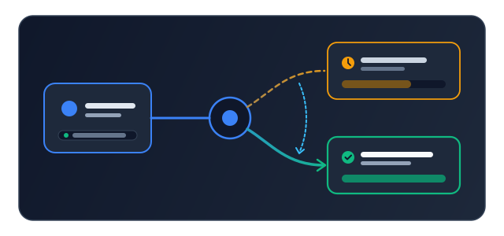

# dsh_multi_api

[](LICENSE)

**给 [DeepSeek Harness](https://github.com/deepseek-ai) 用的多渠道模型中继：一个逻辑模型挂多个 OpenAI 兼容渠道，某个渠道额度耗尽、限流、密钥失效或上游报错时自动切换，对话里无感。**

`dsh_multi_api` 把 new-api 那一层「渠道 + 模型映射 + 故障转移」搬进 DSH 进程内，作为标准 `LlmAdapter` 注册成一个虚拟供应商 `relay`。配好的模型会出现在会话的模型选择器里，用起来和原生模型没有区别。

- **多渠道路由** —— 同一个逻辑模型绑任意多个渠道，按优先级排序、同优先级按权重，失败自动顺延到下一条。
- **自动故障转移** —— 额度耗尽、鉴权失效、限流、`5xx`、超时、上游没有该模型，都会切；已经开始输出之后不再切，避免两段回答拼接。
- **冷却与恢复** —— 额度 30 分钟、密钥失效 12 小时、瞬时限流按 `Retry-After`、连续失败指数退避；状态跨重启保留，也可手动解除。
- **可视化管理** —— 左栏面板里增删改渠道、绑定模型、测连通性、拉上游模型列表、看每次调用走了谁、切了几次。
- **密钥不外泄** —— 存在 DSH 凭证层，不进配置文件、不进日志、不进错误信息。

## 安装 / 更新

需要 DeepSeek Harness `0.2.0-rc.2` 及以上（桌面版、Web 版都可以）。

### 在 DeepSeek Harness 中安装

左栏 **Plugins → Add plugin**，选择本仓库目录，或在搜索框填入 Git 地址后安装。

### 使用 `dsh` CLI 安装

```sh
dsh plugin --profile desktop add git+https://github.com/XiaoCai-dev/dsh_multi_api.git
```

从本地目录安装（开发时用）：

```sh
dsh plugin --profile desktop add /path/to/dsh_multi_api
```

更新：

```sh
dsh plugin --profile desktop add git+https://github.com/XiaoCai-dev/dsh_multi_api.git
```

卸载：

```sh
dsh plugin --profile desktop remove dsh_multi_api
```

装完重启 DSH，左栏出现 **多渠道模型中继**。

## 使用方法

| 入口 | 作用 |
| --- | --- |
| **渠道管理** | 增删改渠道：Base URL、API Key、优先级、权重、超时，以及该渠道支持的模型列表（`逻辑名` 或 `逻辑名=上游名`）。行内可测连通性、拉取上游模型、解除冷却。 |
| **模型路由表** | 每个逻辑模型一张卡，显示故障切换链路（渠道 A → 渠道 B）和每条渠道对应的上游真实模型 ID；可在此手动增删绑定。 |
| **调用与切换日志** | 最近 200 次调用：结果（成功 / 触发切换 / 全部失败）、模型、总耗时、渠道链路，展开看每次尝试的失败码与耗时。 |
| **会话模型选择器** | 配置好的逻辑模型出现在 `Channel relay` 分组下；选中即用。多渠道的模型会带 `×N` 徽章。 |

### 快速开始

1. **渠道管理 → 新增渠道**：Base URL 写到 `/v1` 为止（如 `https://api.deepseek.com/v1`），填 API Key，模型一栏填该渠道支持的模型。
2. 想验证故障转移，就**再加一个渠道**，模型名填同一个，优先级填更大的数字（数字大 = 备用）。
3. 会话输入框上方点模型名 → **模型** → 在 `Channel relay` 分组里选中它。

只配一个渠道时插件不产生任何行为差异，也不会发生切换——故障转移至少要两条渠道服务同一个逻辑模型。

会话日志里 `provider` 恒为 `relay`，看不出实际走了哪个渠道；换渠道的记录只在插件的调用日志里。

## 故障转移规则

| 上游信号 | 失败码 | 换渠道 | 渠道状态 |
| --- | --- | --- | --- |
| 402 / 403 / 429 且命中额度文案（`quota`、`balance`、`insufficient`） | `QUOTA` | 是 | 冷却 30 分钟 |
| 429 限流（带 `Retry-After`） | `RATE_LIMIT` | 是 | 冷却（按响应头，默认 45 秒） |
| 401 / 403 密钥无效 | `INVALID_CREDENTIAL` | 是 | 失效 12 小时，不自动恢复 |
| 404 或「模型不存在」 | `MODEL_UNSUPPORTED` | 是 | 该绑定冷却 5 分钟 |
| 5xx | `SERVER` | 是 | 计数，连续失败才冷却 |
| 连接失败 / 超时 | `TRANSPORT` / `TIMEOUT` | 是 | 指数退避，上限 10 分钟 |
| 200 但空流 | `EMPTY_RESPONSE` | 是（1 次） | 不冷却 |
| 400 参数非法、上下文超长 | `INVALID_REQUEST` / `CONTEXT_WINDOW_EXCEEDED` | 否 | 不冷却 |
| 用户取消 | `aborted` | 否 | 不冷却 |

冷却中的渠道不会从候选里消失，只是排到最后——万一所有渠道都在冷却，至少还能试一次。

同一逻辑模型绑了多条渠道时，对外宣传的能力取**最保守值**：上下文窗口取各渠道最小值，否则按最宽渠道排的计划会撞上更窄的备用渠道。

## 与 `dsh-llm-retry` 的分工

- **本插件**：换渠道，同一个请求在多条渠道之间顺延。
- **`dsh-llm-retry`**：同一条渠道的瞬时抖动重试，以及 step 级重跑。

所以本插件的路由把 `providerRetryPolicy()` 返回 `undefined`——不让宿主重跑一个已经把渠道都试过的请求。

## 数据与隐私

| 内容 | 位置 |
| --- | --- |
| 渠道、模型绑定、冷却状态、调用日志 | `$DSH_HOME/storages/channel_relay/` |
| API Key | `$DSH_HOME/.credentials.yaml`，记录名 `dsh-channel-relay/<channel-id>` |

删渠道会同时清掉它的绑定、冷却状态和密钥；日志只保留最近 200 条。错误信息与日志做脱敏，不会回显密钥或上游原始请求体。

## 已知限制

- **只中转文本**：不声明图片能力，带图请求走 DSH 的降级路径。
- **只支持 OpenAI 兼容协议**（`/chat/completions`）：Anthropic Messages、OpenAI Responses 未实现。
- **不跨进程**：冷却状态是进程内的，两个 DSH 实例各算各的。
- **换渠道对会话日志隐形**：刻意的设计，排查靠插件日志。
- 跨渠道切换会丢上游的 reasoning 签名与 prompt 缓存，属预期代价。

## Roadmap

- [ ] 渠道级 RPM / TPM 限速与并发上限
- [ ] 本地软预算：按钱或按 token 熔断
- [ ] 余额主动探测（对提供 `/balance` 的渠道）
- [ ] Anthropic Messages / OpenAI Responses 协议
- [ ] composer 上的「当前实际渠道」标签
- [ ] 绑定记录行内编辑

## 开发

```sh
node --check index.js    # Host 半
node --check client.js   # Client 半
```

- `index.js` —— `LlmAdapter` 注册、路由决策、SSE → `StreamChunk` 翻译、冷却状态机、存储域与凭证、9 个 RPC 路由
- `client.js` —— 左侧栏图标与主面板，通过 `/api/dsh_multi_api/*` 与 Host 通信
- `DESIGN.md` —— 设计方案与取舍记录（含 DSH 侧能力核对）

## License

[MIT](LICENSE)
