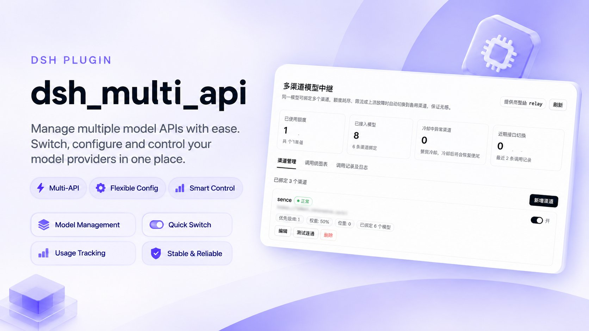

# dsh_multi_api

[简体中文](https://github.com/XiaoCai-dev/dsh_multi_api/blob/main/README.md) · [English](https://github.com/XiaoCai-dev/dsh_multi_api/blob/main/README_en.md) · [日本語](https://github.com/XiaoCai-dev/dsh_multi_api/blob/main/README_ja.md) · [Español](https://github.com/XiaoCai-dev/dsh_multi_api/blob/main/README_es.md) · [Français](https://github.com/XiaoCai-dev/dsh_multi_api/blob/main/README_fr.md) · [Deutsch](https://github.com/XiaoCai-dev/dsh_multi_api/blob/main/README_de.md) · [Русский](https://github.com/XiaoCai-dev/dsh_multi_api/blob/main/README_ru.md) · [Português](https://github.com/XiaoCai-dev/dsh_multi_api/blob/main/README_pt.md)

[](https://github.com/deepseek-ai) [](https://nodejs.org) [](https://developer.mozilla.org/docs/Web/JavaScript)  [](LICENSE)

**Multi-channel model relay for [DeepSeek Harness](https://github.com/deepseek-ai): bind one logical model to several OpenAI-compatible endpoints, and switch silently when a channel runs out of quota, hits a rate limit, loses its key, or fails upstream.**

`dsh_multi_api` brings new-api's "channels + model mapping + failover" layer inside the DSH process. It registers as a regular `LlmAdapter` behind one virtual provider, `relay`. Configured models appear in the conversation's model picker and behave exactly like native models.

- **Multi-channel routing** — bind a logical model to any number of channels; ordered by priority, weighted within a priority, next candidate on failure.
- **Automatic failover** — quota exhaustion, invalid credentials, rate limits, `5xx`, timeouts, or "this endpoint has no such model" all switch. Once visible output has started it stops switching, so two answers are never spliced together.
- **Cooldowns that recover** — 30 minutes for quota, 12 hours for a bad key, `Retry-After` for rate limits, exponential backoff for repeated failures; state survives restarts and can be cleared by hand.
- **Visual management** — add and edit channels, bind models, test connectivity, pull upstream model lists, and see which channel served each call and how many switches it took.
- **Keys stay private** — stored in the DSH credential layer, never in config files, logs, or error messages.

## Install / update

Requires DeepSeek Harness `0.2.0-rc.2` or newer (desktop or web).

### From DeepSeek Harness

Left sidebar **Plugins → Add plugin**: pick this repository's directory, or paste the Git URL into the search box.

### With the `dsh` CLI

```sh
dsh plugin --profile desktop add git+https://github.com/XiaoCai-dev/dsh_multi_api.git
```

From a local directory (for development):

```sh
dsh plugin --profile desktop add /path/to/dsh_multi_api
```

Update:

```sh
dsh plugin --profile desktop add git+https://github.com/XiaoCai-dev/dsh_multi_api.git
```

Uninstall:

```sh
dsh plugin --profile desktop remove dsh_multi_api
```

Restart DSH afterwards; **Channel relay** appears in the left sidebar.

## Usage

| Entry | What it does |
| --- | --- |
| **Channels** | Add, edit, delete channels: Base URL, API key, priority, weight, timeout, and the models this channel serves (`logical` or `logical=upstream`). Inline actions: test connectivity, fetch upstream models, clear cooldown. |
| **Model routes** | One card per logical model, showing the failover chain (channel A → channel B) and the upstream model id behind each channel; bindings can be added or removed here. |
| **Calls & failover** | The last 200 calls: outcome (success / failed over / all channels failed), model, total duration, channel chain; expand a row for each attempt's failure code and timing. |
| **Model picker** | Configured logical models appear under the `Channel relay` group; pick one and go. Models backed by several channels carry a `×N` badge. |

### Quick start

1. **Channels → Add channel**: put the Base URL in up to `/v1` (e.g. `https://api.deepseek.com/v1`), enter the API key, and list the models the channel serves.
2. To try failover, **add a second channel** with the same model name and a larger priority number (bigger number = backup).
3. In a conversation, click the model name above the composer → **Model** → pick it from the `Channel relay` group.

With a single channel the plugin changes nothing and never switches — failover needs at least two channels serving the same logical model.

The session log always records `provider: relay`, so it never shows which channel actually served a call; channel switches live only in this plugin's call log.

### Configuring a channel


The Base URL goes up to `/v1`. The model field accepts `logical` or `logical=upstream` — saving replaces this channel's bindings, and the result shows up in the model picker immediately.

### Using it in a conversation


Pick it and it works like any native model. When a logical model is backed by several channels, the entry carries a `×N` badge — that is the size of the failover pool.

## Failover rules

| Upstream signal | Failure code | Switches | Channel state |
| --- | --- | --- | --- |
| 402 / 403 / 429 matching quota wording (`quota`, `balance`, `insufficient`) | `QUOTA` | yes | cooling for 30 minutes |
| 429 rate limit (with `Retry-After`) | `RATE_LIMIT` | yes | cooling (per header, 45 s default) |
| 401 / 403 invalid key | `INVALID_CREDENTIAL` | yes | invalid for 12 hours, no auto-recovery |
| 404 or "model does not exist" | `MODEL_UNSUPPORTED` | yes | that binding cools for 5 minutes |
| 5xx | `SERVER` | yes | counted; cools only after repeated failures |
| Connection failure / timeout | `TRANSPORT` / `TIMEOUT` | yes | exponential backoff, 10 min cap |
| 200 with an empty stream | `EMPTY_RESPONSE` | yes (once) | no cooldown |
| 400 bad request, context too long | `INVALID_REQUEST` / `CONTEXT_WINDOW_EXCEEDED` | no | no cooldown |
| User cancelled | `aborted` | no | no cooldown |

A cooling channel does not disappear from the candidate list; it just moves to the end — if every channel is cooling, at least one gets tried.

When a logical model has several channels, the advertised capabilities are the **most conservative** ones: the context window is the smallest across channels, otherwise a plan sized for the widest channel would randomly hit a narrower backup.

## Division of labour with `dsh-llm-retry`

- **This plugin**: switches channels — one request walks the channel list.
- **`dsh-llm-retry`**: retries transient blips on the same channel, and re-runs a step.

That is why this route returns `undefined` from `providerRetryPolicy()` — the host must not re-run a request that already tried every channel.

## Data and privacy

| What | Where |
| --- | --- |
| Channels, model bindings, cooldown state, call log | `$DSH_HOME/storages/channel_relay/` |
| API key | `$DSH_HOME/.credentials.yaml`, record `dsh-channel-relay/<channel-id>` |

Deleting a channel also removes its bindings, cooldown state, and key. The call log keeps the last 200 entries. Error messages and logs are redacted: keys and raw upstream request bodies are never echoed.

## Known limitations

- **Text only**: no image capability is declared, so image requests take DSH's degraded path.
- **OpenAI-compatible protocol only** (`/chat/completions`): Anthropic Messages and OpenAI Responses are not implemented.
- **Not cross-process**: cooldown state is in-process; two DSH instances count separately.
- **Channel switches are invisible in the session log**: deliberate; diagnose from this plugin's log.
- Switching channels drops the upstream's reasoning signature and prompt cache — an accepted cost.

## Roadmap

- [ ] Per-channel RPM / TPM limits and concurrency caps
- [ ] Local soft budget: trip on money or tokens
- [ ] Proactive balance probing for channels that expose `/balance`
- [ ] Anthropic Messages / OpenAI Responses protocols
- [ ] A "current channel" label next to the composer
- [ ] Inline editing of bindings

## Development

```sh
node --check index.js    # Host half
node --check client.js   # Client half
```

- `index.js` — `LlmAdapter` registration, routing, SSE → `StreamChunk` translation, cooldown state machine, storage domain and credentials, 9 RPC routes
- `client.js` — sidebar icon and main panel, talking to the host over `/api/dsh_multi_api/*`
- `DESIGN.md` — design rationale and trade-offs (including the DSH capability audit)

## License

[MIT](LICENSE)
