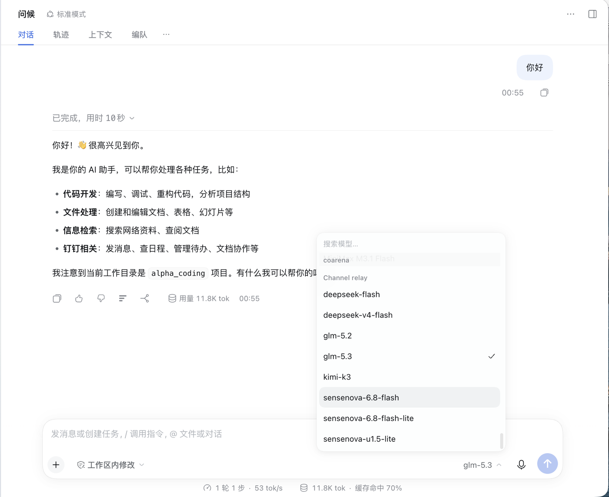

# dsh_multi_api

[简体中文](https://github.com/XiaoCai-dev/dsh_multi_api/blob/main/README.md) · [English](https://github.com/XiaoCai-dev/dsh_multi_api/blob/main/README_en.md) · [日本語](https://github.com/XiaoCai-dev/dsh_multi_api/blob/main/README_ja.md) · [Español](https://github.com/XiaoCai-dev/dsh_multi_api/blob/main/README_es.md) · [Français](https://github.com/XiaoCai-dev/dsh_multi_api/blob/main/README_fr.md) · [Deutsch](https://github.com/XiaoCai-dev/dsh_multi_api/blob/main/README_de.md) · [Русский](https://github.com/XiaoCai-dev/dsh_multi_api/blob/main/README_ru.md) · [Português](https://github.com/XiaoCai-dev/dsh_multi_api/blob/main/README_pt.md)

[](https://github.com/deepseek-ai) [](https://nodejs.org) [](https://developer.mozilla.org/docs/Web/JavaScript)  [](LICENSE)

**Relé multicanal de modelos para [DeepSeek Harness](https://github.com/deepseek-ai): vincula un modelo lógico a varios endpoints compatibles con OpenAI y cambia en silencio cuando un canal se queda sin cuota, sufre un límite de tasa, pierde su clave o falla en origen.**

`dsh_multi_api` traslada dentro del proceso de DSH la capa de «canales + mapeo de modelos + failover» de new-api. Se registra como un `LlmAdapter` normal detrás de un proveedor virtual, `relay`. Los modelos configurados aparecen en el selector de modelos de la conversación y se comportan igual que los nativos.

- **Enrutado multicanal** — un modelo lógico puede apoyarse en cualquier número de canales; orden por prioridad, peso dentro de la misma prioridad, y siguiente candidato si falla.
- **Failover automático** — cuota agotada, credenciales inválidas, límites de tasa, `5xx`, timeouts o «este endpoint no tiene ese modelo» provocan el cambio. Una vez emitida salida visible deja de cambiar, para no empalmar dos respuestas.
- **Enfriamientos que se recuperan** — 30 minutos por cuota, 12 horas por clave inválida, `Retry-After` para límites de tasa, retroceso exponencial para fallos repetidos; el estado sobrevive a reinicios y se puede limpiar a mano.
- **Gestión visual** — añadir y editar canales, vincular modelos, probar conectividad, traer la lista de modelos del origen y ver qué canal atendió cada llamada y cuántos cambios costó.
- **Las claves no se exponen** — viven en la capa de credenciales de DSH; nunca en archivos de configuración, registros ni mensajes de error.

## Instalación / actualización

Requiere DeepSeek Harness `0.2.0-rc.2` o superior (escritorio o web).

### Desde DeepSeek Harness

Barra lateral izquierda **Plugins → Add plugin**: elige el directorio de este repositorio o pega la URL de Git en el buscador.

### Con la CLI `dsh`

```sh
dsh plugin --profile desktop add git+https://github.com/XiaoCai-dev/dsh_multi_api.git
```

Desde un directorio local (para desarrollo):

```sh
dsh plugin --profile desktop add /path/to/dsh_multi_api
```

Actualizar:

```sh
dsh plugin --profile desktop add git+https://github.com/XiaoCai-dev/dsh_multi_api.git
```

Desinstalar:

```sh
dsh plugin --profile desktop remove dsh_multi_api
```

Reinicia DSH; **Channel relay** aparece en la barra lateral izquierda.

## Uso

| Entrada | Qué hace |
| --- | --- |
| **Canales** | Añadir, editar y borrar canales: Base URL, API key, prioridad, peso, timeout y los modelos que sirve el canal (`lógico` o `lógico=origen`). Acciones en línea: probar conectividad, traer modelos del origen, quitar enfriamiento. |
| **Rutas de modelos** | Una tarjeta por modelo lógico con la cadena de failover (canal A → canal B) y el id real del modelo en cada canal; aquí se añaden o quitan vínculos. |
| **Llamadas y failover** | Las últimas 200 llamadas: resultado (éxito / con cambio / todos los canales fallaron), modelo, duración total y cadena de canales; despliega una fila para ver el código de error y el tiempo de cada intento. |
| **Selector de modelos** | Los modelos lógicos configurados aparecen bajo el grupo `Channel relay`; elige uno y listo. Los modelos con varios canales llevan una insignia `×N`. |

### Inicio rápido

1. **Canales → Añadir canal**: pon la Base URL hasta `/v1` (por ejemplo `https://api.deepseek.com/v1`), introduce la API key y enumera los modelos que sirve el canal.
2. Para probar el failover, **añade un segundo canal** con el mismo nombre de modelo y un número de prioridad mayor (número mayor = respaldo).
3. En una conversación, pulsa el nombre del modelo sobre el cuadro de texto → **Modelo** → elígelo en el grupo `Channel relay`.

Con un solo canal el plugin no cambia nada y nunca conmuta: el failover necesita al menos dos canales sirviendo el mismo modelo lógico.

El registro de la sesión siempre anota `provider: relay`, así que nunca muestra qué canal respondió; los cambios viven solo en el registro de llamadas del plugin.

### Configurar un canal


La Base URL se escribe hasta `/v1`. El campo de modelos acepta `lógico` o `lógico=origen`; al guardar se reemplazan los vínculos de ese canal y el resultado aparece de inmediato en el selector.

### Usarlo en una conversación



Se elige y funciona como cualquier modelo nativo. Cuando un modelo lógico se apoya en varios canales, la entrada lleva una insignia `×N`: ese es el tamaño del pool de failover.

## Reglas de failover

| Señal del origen | Código de error | ¿Cambia? | Estado del canal |
| --- | --- | --- | --- |
| 402 / 403 / 429 con texto de cuota (`quota`, `balance`, `insufficient`) | `QUOTA` | sí | enfriado 30 minutos |
| 429 límite de tasa (con `Retry-After`) | `RATE_LIMIT` | sí | enfriado (según cabecera, 45 s por defecto) |
| 401 / 403 clave inválida | `INVALID_CREDENTIAL` | sí | inválido 12 horas, sin recuperación automática |
| 404 o «el modelo no existe» | `MODEL_UNSUPPORTED` | sí | ese vínculo se enfría 5 minutos |
| 5xx | `SERVER` | sí | se cuenta; enfría solo tras fallos repetidos |
| Fallo de conexión / timeout | `TRANSPORT` / `TIMEOUT` | sí | retroceso exponencial, tope de 10 min |
| 200 con flujo vacío | `EMPTY_RESPONSE` | sí (una vez) | sin enfriamiento |
| 400 petición inválida, contexto demasiado largo | `INVALID_REQUEST` / `CONTEXT_WINDOW_EXCEEDED` | no | sin enfriamiento |
| Cancelado por el usuario | `aborted` | no | sin enfriamiento |

Un canal enfriado no desaparece de los candidatos: pasa al final. Si todos están enfriados, al menos uno se intenta.

Cuando un modelo lógico tiene varios canales, las capacidades anunciadas son las **más conservadoras**: la ventana de contexto es la menor entre canales, porque un plan dimensionado para el canal más amplio acabaría chocando con un respaldo más estrecho.

## Reparto con `dsh-llm-retry`

- **Este plugin**: cambia de canal; una petición recorre la lista de canales.
- **`dsh-llm-retry`**: reintenta fallos transitorios en el mismo canal y reejecuta un step.

Por eso esta ruta devuelve `undefined` en `providerRetryPolicy()`: el host no debe repetir una petición que ya probó todos los canales.

## Datos y privacidad

| Qué | Dónde |
| --- | --- |
| Canales, vínculos de modelos, estado de enfriamiento, registro de llamadas | `$DSH_HOME/storages/channel_relay/` |
| API key | `$DSH_HOME/.credentials.yaml`, registro `dsh-channel-relay/<channel-id>` |

Borrar un canal elimina también sus vínculos, su estado de enfriamiento y su clave. El registro guarda las últimas 200 entradas. Los mensajes de error y los registros se depuran: nunca se muestran claves ni el cuerpo original de la petición al origen.

## Limitaciones conocidas

- **Solo texto**: no declara capacidad de imagen, así que las peticiones con imágenes toman la ruta degradada de DSH.
- **Solo protocolo compatible con OpenAI** (`/chat/completions`): Anthropic Messages y OpenAI Responses no están implementados.
- **No es multiproceso**: el estado de enfriamiento vive en el proceso; dos instancias de DSH cuentan por separado.
- **Los cambios de canal son invisibles en el registro de sesión**: es deliberado; diagnostica con el registro del plugin.
- Cambiar de canal pierde la firma de reasoning y la caché de prompt del origen: coste asumido.

## Roadmap

- [ ] Límites RPM / TPM y de concurrencia por canal
- [ ] Presupuesto blando local: cortar por dinero o por tokens
- [ ] Sondeo activo de saldo para canales que expongan `/balance`
- [ ] Protocolos Anthropic Messages / OpenAI Responses
- [ ] Etiqueta de «canal actual» junto al cuadro de texto
- [ ] Edición en línea de los vínculos

## Desarrollo

```sh
node --check index.js    # Mitad Host
node --check client.js   # Mitad Cliente
```

- `index.js` — registro del `LlmAdapter`, enrutado, traducción SSE → `StreamChunk`, máquina de estados de enfriamiento, dominio de almacenamiento y credenciales, 9 rutas RPC
- `client.js` — icono en la barra lateral y panel principal, hablando con el host por `/api/dsh_multi_api/*`
- `DESIGN.md` — rationale de diseño y compromisos (incluye la auditoría de capacidades de DSH)

## License

[MIT](LICENSE)
