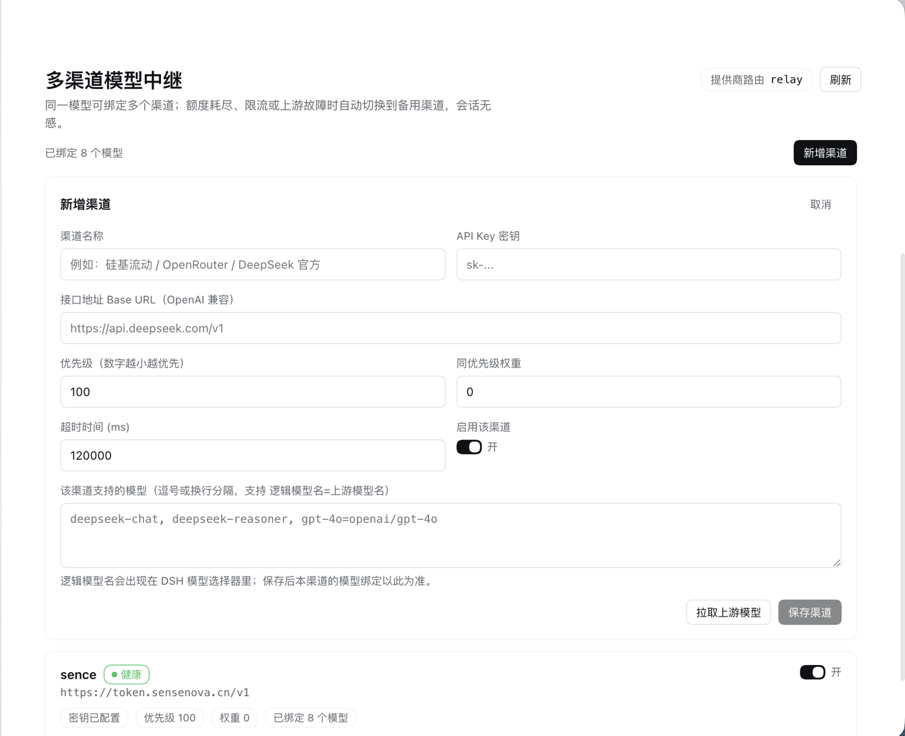

# dsh_multi_api

[简体中文](https://github.com/XiaoCai-dev/dsh_multi_api/blob/main/README.md) · [English](https://github.com/XiaoCai-dev/dsh_multi_api/blob/main/README_en.md) · [日本語](https://github.com/XiaoCai-dev/dsh_multi_api/blob/main/README_ja.md) · [Español](https://github.com/XiaoCai-dev/dsh_multi_api/blob/main/README_es.md) · [Français](https://github.com/XiaoCai-dev/dsh_multi_api/blob/main/README_fr.md) · [Deutsch](https://github.com/XiaoCai-dev/dsh_multi_api/blob/main/README_de.md) · [Русский](https://github.com/XiaoCai-dev/dsh_multi_api/blob/main/README_ru.md) · [Português](https://github.com/XiaoCai-dev/dsh_multi_api/blob/main/README_pt.md)

[](https://github.com/deepseek-ai) [](https://nodejs.org) [](https://developer.mozilla.org/docs/Web/JavaScript)  [](LICENSE)

**[DeepSeek Harness](https://github.com/deepseek-ai) 向けのマルチチャネルモデルリレー。ひとつの論理モデルを複数の OpenAI 互換エンドポイントに紐づけ、残高切れ・レート制限・キー無効・上流障害のときに自動で切り替えます。会話側からは何も見えません。**

`dsh_multi_api` は new-api の「チャネル + モデルマッピング + フェイルオーバー」層を DSH プロセス内に持ち込みます。標準の `LlmAdapter` として仮想プロバイダー `relay` を登録するので、設定したモデルは会話のモデル選択にそのまま現れ、ネイティブモデルと同じように使えます。

- **マルチチャネルルーティング** — ひとつの論理モデルに任意の数のチャネルを紐づけ。優先度順、同一優先度内は重み付き、失敗したら次の候補へ。
- **自動フェイルオーバー** — 残高切れ、認証失敗、レート制限、`5xx`、タイムアウト、「そのモデルが無い」まで切り替え。ただし可視出力が始まった後は切り替えません。二つの回答が混ざるのを防ぐためです。
- **回復するクールダウン** — 残高切れ 30 分、キー無効 12 時間、レート制限は `Retry-After`、連続失敗は指数バックオフ。状態は再起動をまたいで保持され、手動で解除もできます。
- **画面での管理** — チャネルの追加・編集・削除、モデルの紐づけ、疎通テスト、上流モデル一覧の取得、どの呼び出しがどのチャネルを通り何回切り替えたかの確認。
- **キーは外に出ない** — DSH の認証情報レイヤーに保存。設定ファイルにもログにもエラーメッセージにも残しません。

## インストール / 更新

DeepSeek Harness `0.2.0-rc.2` 以降が必要です（デスクトップ版・Web 版どちらでも可）。

### DeepSeek Harness から

左サイドバーの **Plugins → Add plugin** で、このリポジトリのディレクトリを選ぶか、検索欄に Git URL を貼り付けます。

### `dsh` CLI から

```sh
dsh plugin --profile desktop add git+https://github.com/XiaoCai-dev/dsh_multi_api.git
```

ローカルディレクトリから（開発用）：

```sh
dsh plugin --profile desktop add /path/to/dsh_multi_api
```

更新：

```sh
dsh plugin --profile desktop add git+https://github.com/XiaoCai-dev/dsh_multi_api.git
```

アンインストール：

```sh
dsh plugin --profile desktop remove dsh_multi_api
```

インストール後に DSH を再起動すると、左サイドバーに **Channel relay** が現れます。

## 使い方

| 入口 | できること |
| --- | --- |
| **チャネル管理** | チャネルの追加・編集・削除：Base URL、API キー、優先度、重み、タイムアウト、そのチャネルが提供するモデル一覧（`論理名` または `論理名=上流名`）。行内で疎通テスト、上流モデル取得、クールダウン解除。 |
| **モデルルート表** | 論理モデルごとに 1 枚のカード。フェイルオーバーの連鎖（チャネル A → チャネル B）と、各チャネルが指す上流モデル ID を表示。ここで紐づけの追加・削除もできます。 |
| **呼び出しと切り替えログ** | 直近 200 件：結果（成功 / 切り替え発生 / 全滅）、モデル、合計時間、チャネルの連鎖。展開すると各試行の失敗コードと所要時間が見えます。 |
| **モデル選択** | 設定した論理モデルは `Channel relay` グループに現れ、選べばそのまま使えます。複数チャネルで支えるモデルには `×N` バッジが付きます。 |

### クイックスタート

1. **チャネル管理 → チャネルを追加**：Base URL は `/v1` まで（例 `https://api.deepseek.com/v1`）、API キーを入力し、モデル欄にそのチャネルが提供するモデルを書きます。
2. フェイルオーバーを試すなら、**2 つ目のチャネルを追加**し、同じモデル名・より大きい優先度数値（数値が大きい = 予備）にします。
3. 会話の入力欄上にあるモデル名をクリック → **モデル** → `Channel relay` グループから選びます。

チャネルが 1 つだけのときは挙動に何の違いもなく、切り替えも起きません。同じ論理モデルを 2 つ以上のチャネルが提供している必要があります。

セッションログの `provider` は常に `relay` なので、実際にどのチャネルが応答したかは分かりません。切り替えの記録はこのプラグインの呼び出しログにだけ残ります。

### チャネルの設定



Base URL は `/v1` まで。モデル欄は `論理名` または `論理名=上流名` を受け付けます。保存するとこのチャネルの紐づけが置き換わり、結果はすぐモデル選択に反映されます。

### 会話での利用


選べばネイティブモデルと変わりなく動きます。ひとつの論理モデルが複数チャネルで支えられている場合、`×N` バッジが付きます — それがフェイルオーバープールの大きさです。

## フェイルオーバーの判定

| 上流のシグナル | 失敗コード | 切り替え | チャネル状態 |
| --- | --- | --- | --- |
| 402 / 403 / 429 かつ残高文言（`quota`、`balance`、`insufficient`） | `QUOTA` | する | 30 分クールダウン |
| 429 レート制限（`Retry-After` 付き） | `RATE_LIMIT` | する | クールダウン（ヘッダー準拠、既定 45 秒） |
| 401 / 403 キー無効 | `INVALID_CREDENTIAL` | する | 12 時間無効、自動復帰なし |
| 404 または「モデルが存在しない」 | `MODEL_UNSUPPORTED` | する | その紐づけを 5 分クールダウン |
| 5xx | `SERVER` | する | 回数を数え、連続失敗でクールダウン |
| 接続失敗 / タイムアウト | `TRANSPORT` / `TIMEOUT` | する | 指数バックオフ、上限 10 分 |
| 200 だが空ストリーム | `EMPTY_RESPONSE` | する（1 回） | クールダウンなし |
| 400 不正なリクエスト、コンテキスト超過 | `INVALID_REQUEST` / `CONTEXT_WINDOW_EXCEEDED` | しない | クールダウンなし |
| ユーザーによるキャンセル | `aborted` | しない | クールダウンなし |

クールダウン中のチャネルは候補から消えず、末尾に回るだけです。全部がクールダウン中でも、少なくとも一度は試されます。

論理モデルが複数チャネルを持つ場合、対外的に示す能力は**最も控えめな値**になります。コンテキストウィンドウは各チャネルの最小値です。最も広いチャネルに合わせて計画すると、狭い予備チャネルに当たって失敗するためです。

## `dsh-llm-retry` との分担

- **本プラグイン**：チャネルを切り替える。ひとつのリクエストがチャネル一覧を渡り歩きます。
- **`dsh-llm-retry`**：同一チャネルでの一時的な揺らぎの再試行と、step 単位の再実行。

そのため本ルートの `providerRetryPolicy()` は `undefined` を返します。全チャネルを試し終えたリクエストを、ホストに再実行させないためです。

## データとプライバシー

| 内容 | 場所 |
| --- | --- |
| チャネル、モデルの紐づけ、クールダウン状態、呼び出しログ | `$DSH_HOME/storages/channel_relay/` |
| API キー | `$DSH_HOME/.credentials.yaml`、レコード名 `dsh-channel-relay/<channel-id>` |

チャネルを削除すると、その紐づけ・クールダウン状態・キーも消えます。呼び出しログは直近 200 件のみ保持。エラーメッセージとログはマスクされ、キーや上流の生リクエストボディがそのまま出ることはありません。

## 既知の制限

- **テキストのみ**：画像能力を宣言していないため、画像付きリクエストは DSH の縮退経路を通ります。
- **OpenAI 互換プロトコルのみ**（`/chat/completions`）：Anthropic Messages と OpenAI Responses は未実装です。
- **プロセスをまたがない**：クールダウン状態はプロセス内。DSH を 2 つ動かすと別々に数えます。
- **切り替えはセッションログに出ない**：意図的な設計です。調査は本プラグインのログで行います。
- チャネルをまたぐ切り替えでは、上流の reasoning 署名とプロンプトキャッシュが失われます。想定済みのコストです。

## Roadmap

- [ ] チャネル単位の RPM / TPM 制限と同時実行上限
- [ ] ローカルなソフト予算：金額またはトークンで遮断
- [ ] `/balance` を提供するチャネルの残高能動確認
- [ ] Anthropic Messages / OpenAI Responses プロトコル
- [ ] composer 上の「現在の実チャネル」ラベル
- [ ] 紐づけレコードの行内編集

## 開発

```sh
node --check index.js    # Host 側
node --check client.js   # Client 側
```

- `index.js` — `LlmAdapter` 登録、ルーティング、SSE → `StreamChunk` 変換、クールダウン状態機械、ストレージドメインと認証情報、9 本の RPC ルート
- `client.js` — サイドバーのアイコンとメインパネル。`/api/dsh_multi_api/*` で Host と通信
- `DESIGN.md` — 設計方針とトレードオフ（DSH 側の能力調査を含む）

## License

[MIT](LICENSE)
