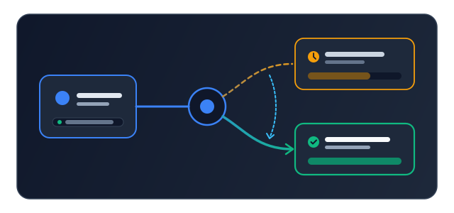

# Channel relay

Put one model on several OpenAI-compatible endpoints and let the plugin decide which endpoint serves each call.

## What it does

- **One logical model, many channels.** A model id you define (`deepseek-chat`, `gpt-5`, `my-cheap-pool`) is bound to any number of channels. The binding is what appears in the model picker, under the `relay` provider group.
- **Automatic failover.** Quota exhaustion, rate limits, invalid keys, `5xx`, timeouts, or "this endpoint has no such model" move the call to the next channel in the chain. Once a channel has produced visible content the call is committed, so a mid-stream failure never splices two answers together.
- **Cooldowns that persist.** A quota failure cools the channel for 30 minutes, an invalid key for 12 hours, transient errors back off exponentially. State survives restarts and can be cleared per channel.
- **A sidebar page** for channels, model routes, and the call log — including a connectivity test and an upstream model list you can click to fill the model field.

## Where to configure it

Left sidebar → **Channel relay**. Add two channels that serve the same model id, then pick that model in a conversation's model picker. Break one channel's key on purpose and watch the next message land on the other channel: the log records a `failover` and the broken channel turns into *Invalid key*.

## Notes

- API keys live in the credential store, never in the patch file or the logs.
- The session log always records the provider as `relay`: channel switches are deliberately invisible there and visible only in this plugin's call log.
- Images are not routed; keep vision work on a vision-capable provider.
