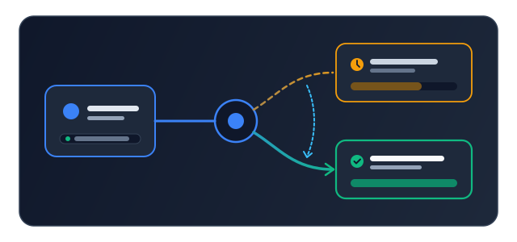

# 多渠道模型中继

把一个模型挂到多个 OpenAI 兼容接口上，每次调用由插件决定走哪一个渠道。

## 它做什么

- **一个逻辑模型，多个渠道。** 你自己定义的模型 ID（`deepseek-chat`、`gpt-5`、`my-cheap-pool`）可以绑定任意多个渠道；进入模型选择器的是这个逻辑模型，分组为 `relay`。
- **自动故障转移。** 额度耗尽、限流、密钥失效、`5xx`、超时、以及「该接口没有这个模型」，都会把这次调用顺延到链路里的下一个渠道。一旦某个渠道已经吐出可见内容，这次调用即视为提交，中途失败不会把两段回答拼在一起。
- **会持久化的冷却。** 额度耗尽冷却 30 分钟，密钥失效 12 小时，瞬时错误指数退避；状态跨重启保留，也可以按渠道手动解除。
- **一个左侧栏页面**：渠道、模型路由表、调用日志，附带连通性测试，以及点一下就能填入模型列表的上游模型拉取。

## 在哪里配置

左侧栏 → **多渠道模型中继**。添加两个服务同一模型 ID 的渠道，然后在会话的模型选择器里选中该模型。故意把其中一个渠道的密钥改错，下一条消息就会落到另一个渠道：日志里出现一条 `触发自动切换`，出错的渠道变成「密钥失效」。

## 注意

- API Key 只存在凭证层，不写进补丁文件，也不进日志。
- 会话日志里的 provider 恒为 `relay`：换渠道对会话日志是隐形的，只在本插件的调用日志里可见。
- 不中转图片：需要看图的场景请使用支持视觉的供应商。
